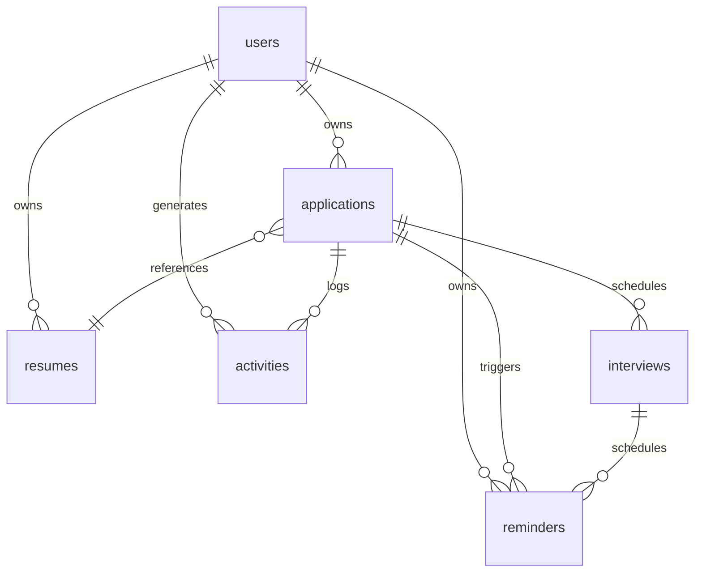

# Database Architecture & Schema Design

## Overview

The database design uses PostgreSQL with SQLAlchemy ORM and Alembic migrations. All timestamps are timezone-aware and stored in UTC. Referential integrity is strictly enforced with foreign keys, cascading deletions on owned resources, and explicit indexes on queried columns.

## Entity Relationship Summary

## Tables & Columns

### 1. `users`
Represents application accounts.
- `id` (INTEGER, PK): Unique user identifier.
- `full_name` (VARCHAR(100), NOT NULL): User's legal or professional display name.
- `email` (VARCHAR(255), UNIQUE, NOT NULL, INDEX): Primary authentication identifier.
- `password_hash` (VARCHAR(255), NOT NULL): Werkzeug-generated scrypt/pbkdf2 hash.
- `timezone` (VARCHAR(50), NOT NULL, DEFAULT 'UTC'): User's preferred display timezone.
- `created_at` (TIMESTAMP WITH TIME ZONE, NOT NULL): Account creation timestamp in UTC.
- `updated_at` (TIMESTAMP WITH TIME ZONE, NOT NULL): Account update timestamp in UTC.

### 2. `applications`
Central entity representing a tracked job application.
- `id` (INTEGER, PK): Unique application identifier.
- `user_id` (INTEGER, FK -> users.id ON DELETE CASCADE, NOT NULL, INDEX): Owner user ID.
- `company_name` (VARCHAR(150), NOT NULL, INDEX): Organization name.
- `job_title` (VARCHAR(150), NOT NULL, INDEX): Role or position title.
- `job_url` (VARCHAR(1024), NULLABLE): Web link to job description.
- `location` (VARCHAR(150), NULLABLE): Geographic location or workspace arrangement.
- `employment_type` (VARCHAR(50), NULLABLE): Full-time, Part-time, Contract, Internship, Freelance.
- `work_arrangement` (VARCHAR(50), NULLABLE): Remote, Hybrid, On-site.
- `salary` (VARCHAR(100), NULLABLE): Target or stated compensation.
- `status` (VARCHAR(50), NOT NULL, DEFAULT 'Applied', INDEX): Saved, Applied, Assessment, Interview, Offer, Rejected, Withdrawn.
- `applied_at` (DATE, NULLABLE): Date on which the user applied.
- `deadline` (TIMESTAMP WITH TIME ZONE, NULLABLE, INDEX): Application or assessment deadline.
- `notes` (TEXT, NULLABLE): Markdown/plain notes regarding the opportunity.
- `resume_id` (INTEGER, FK -> resumes.id ON DELETE SET NULL, NULLABLE): Resume version utilized.
- `created_at` (TIMESTAMP WITH TIME ZONE, NOT NULL): Record creation timestamp.
- `updated_at` (TIMESTAMP WITH TIME ZONE, NOT NULL): Last modification timestamp.

### 3. `resumes`
Metadata for uploaded resume documents.
- `id` (INTEGER, PK): Unique resume identifier.
- `user_id` (INTEGER, FK -> users.id ON DELETE CASCADE, NOT NULL, INDEX): Owner user ID.
- `original_filename` (VARCHAR(255), NOT NULL): Original client filename.
- `stored_filename` (VARCHAR(255), UNIQUE, NOT NULL): Secure UUID-based storage filename on disk.
- `content_type` (VARCHAR(100), NOT NULL): Verified MIME type (`application/pdf`, `application/vnd.openxmlformats-officedocument.wordprocessingml.document`).
- `file_size` (INTEGER, NOT NULL): File size in bytes.
- `created_at` (TIMESTAMP WITH TIME ZONE, NOT NULL): Upload timestamp.

### 4. `interviews`
Interview rounds scheduled for an application.
- `id` (INTEGER, PK): Unique interview identifier.
- `application_id` (INTEGER, FK -> applications.id ON DELETE CASCADE, NOT NULL, INDEX): Parent application ID.
- `interview_type` (VARCHAR(50), NOT NULL): Phone screening, Technical interview, HR interview, Hiring manager interview, Final interview, Other.
- `scheduled_at` (TIMESTAMP WITH TIME ZONE, NOT NULL, INDEX): Scheduled interview time in UTC.
- `timezone` (VARCHAR(50), NOT NULL, DEFAULT 'UTC'): Timezone for scheduling context.
- `meeting_location` (VARCHAR(500), NULLABLE): Virtual meeting link or physical location.
- `notes` (TEXT, NULLABLE): Preparation notes or interviewer feedback.
- `status` (VARCHAR(50), NOT NULL, DEFAULT 'Scheduled'): Scheduled, Completed, Cancelled.
- `created_at` (TIMESTAMP WITH TIME ZONE, NOT NULL): Record creation timestamp.
- `updated_at` (TIMESTAMP WITH TIME ZONE, NOT NULL): Last modification timestamp.

### 5. `reminders`
Proactive deadline and interview reminders.
- `id` (INTEGER, PK): Unique reminder identifier.
- `user_id` (INTEGER, FK -> users.id ON DELETE CASCADE, NOT NULL, INDEX): Recipient user ID.
- `application_id` (INTEGER, FK -> applications.id ON DELETE CASCADE, NULLABLE, INDEX): Linked application.
- `interview_id` (INTEGER, FK -> interviews.id ON DELETE CASCADE, NULLABLE, INDEX): Linked interview.
- `reminder_at` (TIMESTAMP WITH TIME ZONE, NOT NULL, INDEX): When the reminder should trigger in UTC.
- `status` (VARCHAR(50), NOT NULL, DEFAULT 'Pending'): Pending, Completed, Cancelled, Dismissed.
- `processed_at` (TIMESTAMP WITH TIME ZONE, NULLABLE): Timestamp when alert was dispatched.
- `created_at` (TIMESTAMP WITH TIME ZONE, NOT NULL): Record creation timestamp.

### 6. `activities`
Audit log of application and job search events.
- `id` (INTEGER, PK): Unique activity record identifier.
- `user_id` (INTEGER, FK -> users.id ON DELETE CASCADE, NOT NULL, INDEX): Action performer ID.
- `application_id` (INTEGER, FK -> applications.id ON DELETE SET NULL, NULLABLE, INDEX): Associated application.
- `event_type` (VARCHAR(50), NOT NULL): Event classification (`application_created`, `status_changed`, etc.).
- `description` (VARCHAR(255), NOT NULL): Human-readable event description.
- `created_at` (TIMESTAMP WITH TIME ZONE, NOT NULL, INDEX): Event timestamp in UTC.
